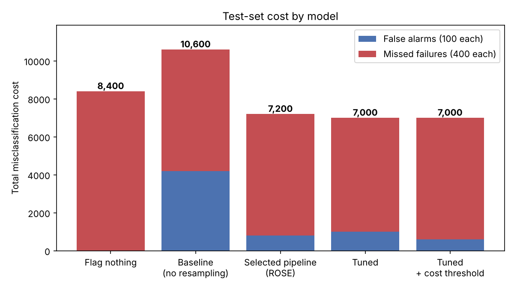
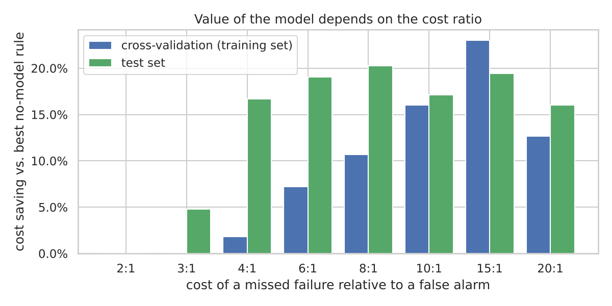
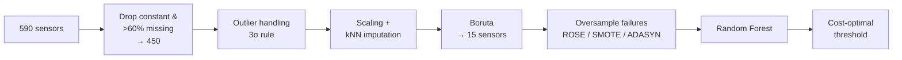

# Predicting Defective Semiconductor Wafers (UCI SECOM)

[](https://github.com/<ndang257>/secom-faulty-wafer-detection/actions/workflows/ci.yml)


Can sensor readings collected during wafer fabrication flag defective wafers before the final electrical test?
This project builds a cost-aware classifier for the [SECOM dataset](https://doi.org/10.24432/C54305):
1,567 wafers, 590 unlabelled sensors and only 104 failures (6.6 %).

**In short:** the sensors carry a real but weak signal (test ROC-AUC 0.70). After a leak-free re-evaluation,
the model saves money only when a missed failure costs several times more than a false alarm. I think that is
a more useful answer than the optimistic one the project first gave.

## Results

The final model is a Random Forest on 15 sensors selected by Boruta, trained with ROSE oversampling. Each
missed failure costs 400 and each false alarm costs 100.

| Model (test set, 314 wafers, 21 failures) | Recall | Precision | ROC-AUC | False alarms | Missed | **Cost** |
|---|---:|---:|---:|---:|---:|---:|
| Flag nothing (no model) | 0.00 | – | 0.50 | 0 | 21 | 8,400 |
| Random Forest, no resampling | 0.24 | 0.11 | 0.70 | 42 | 16 | 10,600 |
| **Final model** (ROSE, tuned, cost threshold) | 0.24 | 0.45 | 0.70 | 6 | 16 | **7,000** |

<p align="center"></p>

- **17 % cheaper than flagging nothing on the test set.** With only 21 test failures, though, the 95 %
  bootstrap interval for the cost (4,000–10,400) still includes 8,400.
- **In cross-validation, the model saves about 2 % at the assumed 4:1 cost ratio, but 7–23 % once a missed
  failure costs 6–15× a false alarm.** The real cost ratio is the key question to settle with the fab before
  using the model.

<p align="center"></p>

- **15 of 450 usable sensors carry the signal.** They form a short watchlist for process engineers. They are
  associations, not proven causes.

## Approach



- **One pipeline, no leakage.** All steps live in a single `imblearn` pipeline, so cross-validation refits
  every step (including Boruta and oversampling) on each training fold. The test set is used once, at the end.
- **Selected by business cost, not accuracy.** 48 combinations of outlier handling × scaler × resampler were
  compared with 5-fold CV, then the Random Forest was tuned and the decision threshold chosen on
  out-of-fold predictions.
- **Interpretable features.** Boruta keeps original sensors (unlike PCA), so the output is a list of sensors
  engineers can investigate.

### What changed from the original course project

This started as a project in an MSc course at HTW Berlin, written up with the CRISP-DM framework. When I
refactored it, I found two problems in how it had been evaluated:

1. The best preprocessing pipeline was **chosen by its cost on the test set**.
2. Oversampling happened **before cross-validation**, so synthetic copies of a failure could sit in both the
   training and validation folds.

Both inflate the scores. Fixed, test ROC-AUC dropped from 0.78 to 0.70 and recall from 0.43 to 0.24. The
modelling ideas stayed the same; what changed was how honestly they were measured.

## Repository structure

```
├── data/raw/                 SECOM data (CC BY 4.0) – see data/README.md
├── notebooks/
│   ├── 01_eda.ipynb                              data quality, class balance, drift
│   ├── 02_preprocessing_feature_selection.ipynb  each pipeline step explained
│   └── 03_modeling_evaluation.ipynb              model selection, test results, cost analysis
├── src/secom/                reusable package (data, preprocessing, Boruta, ROSE, evaluation, pipeline)
├── scripts/train.py          end-to-end training and evaluation
├── reports/                  result tables (CSV/JSON) and figures produced by train.py
└── tests/                    unit tests (pytest)
```

## How to run

```bash
git clone https://github.com/<ndang257>/secom-faulty-wafer-detection.git
cd secom-faulty-wafer-detection
python -m venv .venv && source .venv/bin/activate   # Windows: .venv\Scripts\activate
pip install -e ".[dev]"

pytest                            # unit tests (seconds)
python scripts/train.py --quick   # small check run, ~3 min, writes to reports/quick/
python scripts/train.py           # full run, ~50 min on 2 CPU cores, writes to reports/
```

The notebooks run from the committed results in `reports/`, so you don't need to retrain to read them.
Notebook 02 refits Boruta once (about a minute).

## Limitations and next steps

- **Time-based validation.** The weekly failure rate falls from 10–20 % in July and August to mostly under
  5 % from September on (see notebook 01). A random split hides this drift; training on earlier wafers and
  testing on later ones would be more realistic.
- **Probability calibration** so the threshold can be set from the cost ratio directly.
- **Other models:** gradient boosting and a regularised logistic regression as baselines.
- **Small sample:** 104 failures limit any model. More failure data would help more than more tuning.

## Data

McCann, M. & Johnston, A. (2008). *SECOM* [Dataset]. UCI Machine Learning Repository.
https://doi.org/10.24432/C54305 (CC BY 4.0).

## License

Code: [MIT](LICENSE). Data: CC BY 4.0, see [data/README.md](data/README.md).
